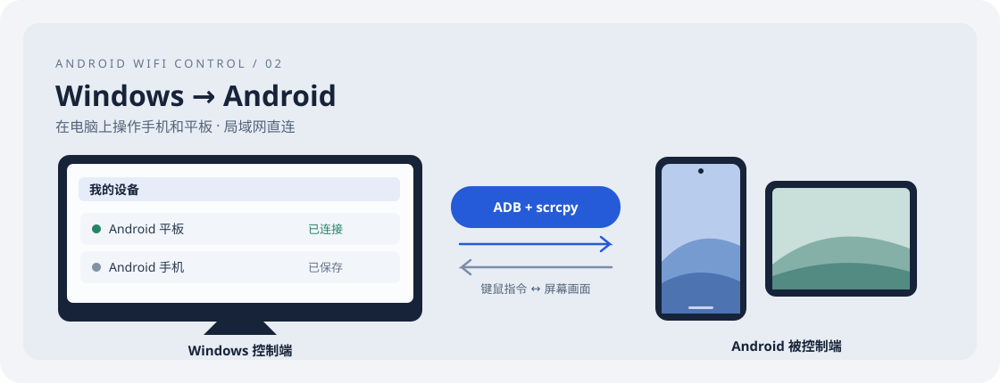
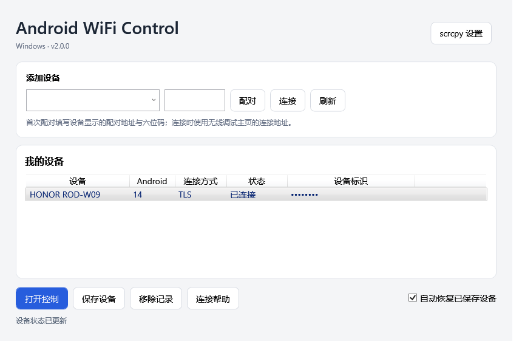
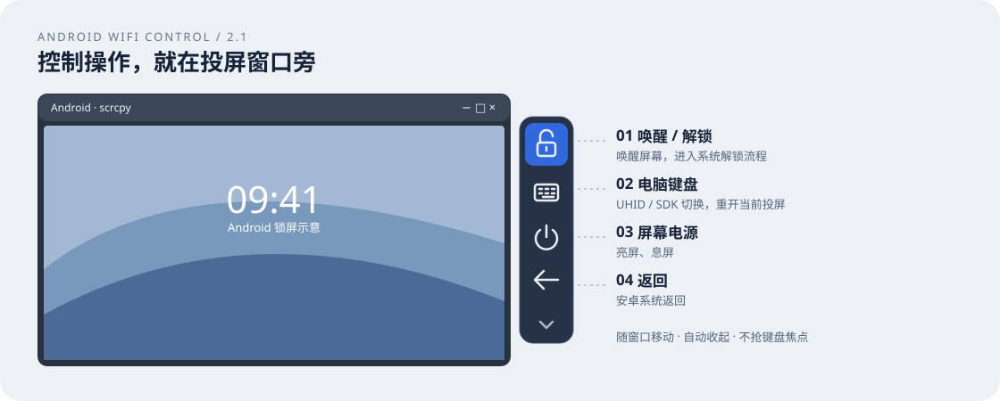
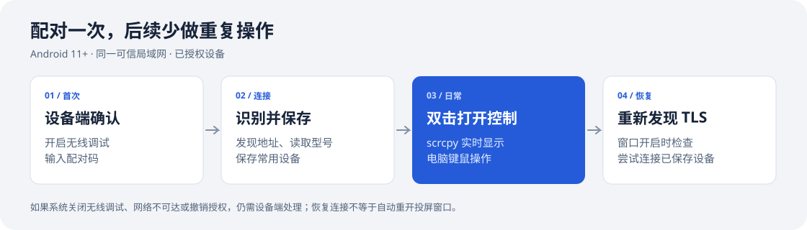

<div align="center">

# Android WiFi Control

**让 Windows 电脑轻松控制安卓手机与平板的无线控制方案**

无线配对 · 自动发现 · 多设备管理 · scrcpy 投屏与键鼠控制

[](#兼容性) [](https://github.com/rizetngan/android-wifi-control/releases/latest) 

简体中文 · [English](README.en.md)

[功能](#功能) · [方案对比](#为什么选择-android-wifi-control) · [下载安装](#下载安装) · [PowerShell 安装](#powershell-安装) · [Agent 安装](#使用-agent-安装) · [使用方法](#使用方法) · [兼容性](#兼容性)

</div>

<p align="center">

</p>

<p align="center">

<br><sub>v2.0.0 实际 WPF 界面 · 荣耀 V8 Pro / Android 14 · TLS 已连接（设备编号及本地路径已隐藏）</sub>
</p>


Android WiFi Control 由 [rizetngan](https://github.com/rizetngan) 维护，基于成熟的 ADB 与 [scrcpy](https://github.com/Genymobile/scrcpy) 让 Windows 电脑作为控制端，通过 Wi-Fi 或 USB 连接安卓手机和平板，在电脑上查看设备画面并使用键盘、鼠标直接操作。它不重复实现投屏引擎，而是简化设备发现、首次配对和断线重连的过程。

## 2.1.0 · 控制窗口旁的快捷操作

<p align="center">

<br><sub>使用场景示意图；安卓锁屏画面为示意，并非实机截屏。</sub>
</p>

<table><tr><td width="96" align="center"></td><td>

**四个快捷操作，不必切回设备管理器。**

- **唤醒 / 解锁**：亮起设备屏幕并请求系统解锁界面。设置 PIN 或密码的设备仍需正常验证。
- **电脑键盘**：默认 UHID 物理键盘输入，支持切换 SDK 兼容模式（会重新打开当前投屏）。
- **亮屏 / 息屏**：控制设备屏幕电源。
- **返回**：直接执行安卓返回操作。

侧栏随 scrcpy 窗口移动和缩放，移出约 2 秒收起，移入展开；切换其他应用或最小化时隐藏。

</td></tr></table>

<sub>工具栏图片来自实际 WPF 控件渲染，未采集安卓个人内容。</sub>

荣耀 V8 Pro / Android 14 已通过用户实际体验验收，以及窗口跟随、展开收起、最小化恢复、键盘模式切换、唤醒联动回归测试。

## 功能

- **一键打开控制**：从电脑端直接使用键盘、鼠标操作已授权的安卓手机和平板。
- **图形化无线配对**：输入设备端显示的配对地址和六位码，无需手动编写 ADB 命令。
- **设备自动发现**：通过 mDNS 读取局域网服务地址，并自动获取在线设备的厂商、型号和 Android 版本。
- **多设备管理**：保存常用设备；同一设备的 USB、TLS 或传统 TCP 连接按设备标识去重。
- **连接恢复**：窗口开启时定期检查已保存设备，尝试恢复匹配的 TLS 无线连接。
- **轻量运行**：原生 WPF 界面，复用官方 scrcpy，不需要额外投屏引擎；配置保存在本地。

## 为什么选择 Android WiFi Control？

**它不是另一个投屏引擎，而是把成熟的 scrcpy 变成更容易日常使用的 Windows 控制方案。** 对已经拥有安卓手机或平板的用户，核心价值是减少重复配置，而不是增加一套远程服务。

| 对比维度 | Android WiFi Control | 原生 scrcpy / ADB | Windows 手机连接（Phone Link） | AirDroid Cast |
| --- | --- | --- | --- | --- |
| 主要定位 | Windows 控制个人安卓设备 | 高效投屏与控制引擎 | 手机与 Windows 的通知、通话、应用协同 | 跨平台投屏及远程控制 |
| 安卓设备范围 | 具备相应 ADB 能力的设备；实际权限因厂商而异 | Android 5+，无线依系统版本配置 | 手机屏幕功能限官方支持的设备及市场 | 依其客户端、权限与系统支持 |
| 首次配置 | 图形化配对和连接，需设备确认 | ADB 配对、连接命令；也提供无线启动参数 | Link to Windows 配对、账号及权限配置 | 客户端配对与相应控制授权 |
| 常用设备 | 本地保存设备、型号识别、连接去重 | 支持选择设备，可通过脚本扩展 | 内置设备关联与手机协同 | 支持多设备投屏 |
| 连接恢复 | 应用运行期间尝试恢复已保存设备的 TLS 连接 | ADB 支持发现/重连；可自行组合脚本 | 由手机连接服务管理 | 由其客户端及服务管理 |
| 账号与网络 | 日常局域网控制无需本项目账号或云中转 | 无账号；支持 USB/TCP | 依微软账号与配对流程 | 支持跨网络投屏；按产品功能及套餐配置 |
| 费用 | 当前发行包无需付费，scrcpy 免费 | 免费、开源 | Windows 自带/免费应用 | 免费基础投屏；部分控制及远程功能需付费 |

资料来源：[scrcpy 官方功能](https://github.com/Genymobile/scrcpy) · [scrcpy 无线连接](https://github.com/Genymobile/scrcpy/blob/master/doc/connection.md) · [Phone Link 支持设备](https://support.microsoft.com/zh-cn/windows/apps/phonelink/supported-devices-for-phone-link-experiences) · [Phone Link 配置](https://support.microsoft.com/en-gb/windows/apps/phonelink/phone-link-requirements-and-setup) · [AirDroid Cast 官方指南](https://www.airdroid.com/guide/cast/) · [AirDroid Cast 免费与付费权益](https://help.airdroid.com/hc/en-us/articles/16783993952411-What-the-different-between-AirDroid-Cast-Premium-Free-account)。

### 从命令操作到日常设备管理

<p align="center"><br><sub>连接流程示意 · 无需每次手动输入连接命令</sub></p>

**与原生 scrcpy 的关系：** scrcpy 本身已经具备出色的投屏、键鼠控制及无线连接能力。本项目的增量是 Windows 图形界面、常用设备记录、自动发现地址、重复连接去重及运行期间的连接检查。不宣称投屏延迟或画质优于 scrcpy。

**与商业远控的取舍：** 优先服务同一可信网络内的个人设备，不要求额外注册账号或订阅本项目，也不提供公网远程访问、企业设备管理或手机通知同步。若需要跨互联网远程控制，商业方案可能更适合。

## 使用场景

| 场景 | 使用方式 |
| --- | --- |
| 办公时操作平板 | 保存平板后，从设备列表打开控制窗口 |
| 同时管理手机与平板 | 选择对应设备，不必反复输入设备地址 |
| 安卓应用测试 | 使用 USB 或已授权 Wi-Fi 连接，快速切换设备 |
| 无线地址变化 | 刷新发现地址；已保存设备优先尝试 TLS 恢复 |

## 下载安装

**v2.1.0 正式发行版** · Windows · Windows PowerShell 5.1 / WPF

**[下载 Windows ZIP](https://github.com/rizetngan/android-wifi-control/releases/download/v2.1.0/Android-WiFi-Control-v2.1.0-Windows.zip)** · [发布说明](https://github.com/rizetngan/android-wifi-control/releases/tag/v2.1.0) · [SHA-256 校验](https://github.com/rizetngan/android-wifi-control/releases/download/v2.1.0/SHA256SUMS.txt) · [全部版本](https://github.com/rizetngan/android-wifi-control/releases)

发行包包含图形化启动器、ADB 连接模块、投屏侧边工具栏及桌面快捷方式脚本，不需要编译或安装开发工具。它不是独立 EXE 安装器；需另外下载 [官方 scrcpy Windows 发行包](https://github.com/Genymobile/scrcpy/releases)，并在首次启动时选择包含 adb.exe 和 scrcpy.exe 的目录。

解压后双击 `Start-AndroidControl.bat` 即可运行。

## PowerShell 安装

在 Windows PowerShell 中复制执行：

```powershell
$ErrorActionPreference = 'Stop'
$script = Join-Path $env:TEMP 'install-android-wifi-control.ps1'
Invoke-WebRequest -UseBasicParsing 'https://raw.githubusercontent.com/rizetngan/android-wifi-control/main/scripts/install-windows.ps1' -OutFile $script
powershell.exe -NoProfile -ExecutionPolicy Bypass -File $script
```

脚本从本仓库 GitHub Releases 获取最新正式版 ZIP，核对 SHA-256，安装至 `%LOCALAPPDATA%\Programs\AndroidWiFiControl`，创建桌面快捷方式并启动。已有本地设备配置保留；若应用正在运行，先退出再安装。首次运行仍需选择官方 scrcpy 目录。

[安装脚本源码](scripts/install-windows.ps1) · 仅下载并校验：在最后一行追加 `-DownloadOnly`。

## 使用 Agent 安装

将以下指令复制给能够操作 Windows 电脑的 Agent（例如 ChatGPT Work、Codex 或 Claude Code）：

```text
请帮我在这台 Windows 电脑安装 Android WiFi Control 最新正式版：
https://github.com/rizetngan/android-wifi-control

1. 检查 Windows 版本与架构，从上述仓库 GitHub Releases 下载最新正式版 Windows ZIP 和同版本 SHA256SUMS.txt；校验 SHA-256，不一致则停止。
2. 检查是否已安装，保留 android.local.json 等已有配置；使用仓库提供的 PowerShell 安装脚本或解压至用户程序目录并创建桌面快捷方式。
3. 检查现有 scrcpy 及 adb.exe；如未安装，仅从 https://github.com/Genymobile/scrcpy/releases 下载适配 Windows 架构的官方发行包。
4. 启动 Android WiFi Control 并选择 scrcpy 目录。指导我在安卓设备上开启开发者选项，并自行确认 USB 调试或无线调试首次配对。
5. 验证设备发现、连接与 scrcpy 控制窗口启动。告诉我版本、安装路径、校验结果和需要我确认的设备操作。
6. 不上传配对码、ADB 私钥或本地配置，不启用公网 ADB，不擅自修改系统安全设置。
```

## 使用方法

### 无线连接（Android 11+）

1. 将电脑和安卓设备连接至同一可信局域网。
2. 在设备上开启开发者选项与无线调试，选择「使用配对码配对设备」。
3. 在 Android WiFi Control 填入设备显示的配对 IP:端口、六位配对码，点击「配对」。
4. 等待 ADB 自动发现，或填入无线调试主页显示的**连接地址**并点击「连接」。配对端口与连接端口不同。
5. 选择已连接设备，双击或点击「打开控制」；点击「保存设备」可开启已保存设备的恢复检查。

### USB 连接

使用数据线连接电脑与安卓设备，在设备端确认 USB 调试授权，然后刷新设备列表并打开控制。

### 投屏侧边工具栏与电脑键盘

- 从设备管理器打开控制窗口后，侧边工具栏随 scrcpy 窗口移动、缩放；鼠标离开约 2 秒自动收起，移入展开，最小化或切换其他应用时隐藏。点击工具栏的解锁图标，唤醒屏幕并请求安卓系统显示解锁界面。若设有 PIN、密码等，仍由用户正常输入；不会保存或自动输入解锁凭据。
- 默认使用 scrcpy UHID 物理键盘。打开控制窗口后点击安卓文本框，使用电脑键盘输入。第一次可按 Alt+K 在安卓物理键盘设置中匹配键盘布局；也可通过安卓输入法输入中文，或在应用支持时使用 Ctrl+V 粘贴。
- 部分旧系统不支持 UHID 时，可点击侧栏键盘图标切换模式并重新打开当前投屏，或在设备管理器中选择兼容键盘。侧栏也提供屏幕电源与安卓返回按钮。

## 兼容性

| 系统 | 连接方式 | 说明 |
| --- | --- | --- |
| Android 5–10 | USB / 已授权传统 TCP | 无线连接需按 scrcpy 上游说明通过 USB 初始化 |
| Android 11+ | USB / TLS 无线调试 | 推荐 TLS 无线连接 |
| MagicOS、MIUI、HyperOS、ColorOS、OriginOS、One UI、EMUI、Pixel | 按设备实际 ADB 能力 | 厂商权限与后台限制各有差异 |
| HarmonyOS NEXT 等非 Android 环境 | 不支持 | 不具备 Android ADB 能力 |

Android 5+ 为 scrcpy 上游支持范围；项目目前仅在荣耀 V8 Pro 上完成真机验证，并非上述所有品牌均已实测。部分系统需要单独授予输入控制权限。

## 重连与保活

默认使用已授权的 TLS 连接。应用运行时仅对已保存设备匹配的 TLS mDNS 服务尝试重新连接；关闭窗口后停止检查，不会自动重开用户关闭的投屏窗口。若无线调试被系统关闭、网络隔离或授权被撤销，需要在安卓端重新处理。

荣耀 V8 Pro 的 V1 原始方案使用 Wireless ADB Keeper、Termux、Termux:Boot 和可选 Shizuku 辅助恢复。已完成 120 秒息屏（连接保持期间）及一次重启恢复验证。其他机型的后台保活需要根据系统分别配置。

[查看 V1.0.0 荣耀配置指南](https://github.com/rizetngan/android-wifi-control/tree/v1.0.0) · [Keeper 上游项目](https://github.com/MBanucu/wireless-adb-keeper)

传统 TCP ADB 不具备 TLS 加密，只应在自己管理的可信网络使用；不要向公网转发 ADB 端口。

## 开发与验证

```powershell
git clone https://github.com/rizetngan/android-wifi-control.git
cd android-wifi-control
powershell.exe -NoProfile -ExecutionPolicy Bypass -File .\tests\Test-Core.ps1
powershell.exe -NoProfile -ExecutionPolicy Bypass -STA -File .\Android-WiFi-Control.ps1 -SmokeTest
```

- Windows PowerShell 5.1 / WPF，复用外部 ADB 与 scrcpy。
- 真机：荣耀 V8 Pro，Android 14；设备元数据、TLS 与传统无线连接识别、界面刷新及设备去重通过。
- 待扩大验证：其他品牌、首次配对、旧版 USB、网络切换、长时间待机恢复。
- V1 启动脚本及历史 Release 保留，旧用户可继续使用原有入口。

本地配置 `android.local.json` 已排除在 Git 版本管理之外。移除设备记录不会撤销安卓端的 ADB 授权。

## 致谢

感谢 [Genymobile/scrcpy](https://github.com/Genymobile/scrcpy)、[Android ADB](https://developer.android.com/tools/adb)、[Wireless ADB Keeper](https://github.com/MBanucu/wireless-adb-keeper)、[Termux](https://github.com/termux/termux-app)、[Termux:Boot](https://github.com/termux/termux-boot) 与 [Shizuku](https://github.com/RikkaApps/Shizuku)。

本项目独立开发与维护，不是任何手机厂商或上述项目的官方产品；第三方程序由用户从其官方渠道安装，分别遵循对应许可。

[问题反馈](https://github.com/rizetngan/android-wifi-control/issues)
